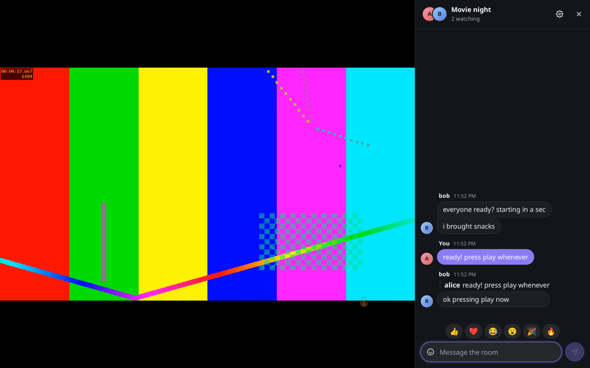
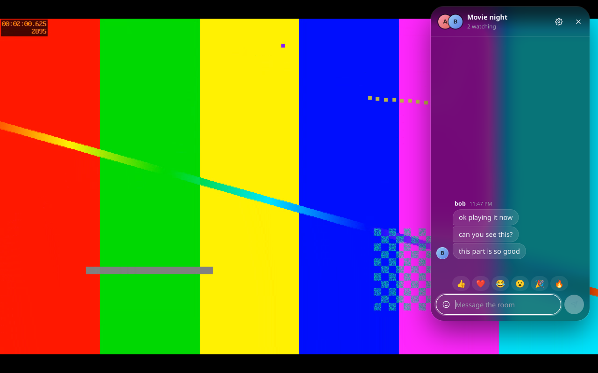

<p align="center"></p>

# JellyChat

**Watch together. Chat in sync.**

Chat for Jellyfin SyncPlay watch parties. It lives inside Jellyfin Web, uses the SyncPlay group as the room, and needs no extra server or port.

| Violet, docked | Glass, floating |
| --- | --- |
|  |  |

## Features

- Room chat with replies, copy, jump-to-original and typing indicators.
- Two built-in themes, Violet and Glass, plus one admin-only Custom theme with your own colors, corners and blur.
- Docked layout that makes room beside the video, or a floating layout with a quiet button, toasts, a peek card and an open card.
- Quick emoji reactions that float over the video, a searchable emoji picker, favorites and recent emoji.
- Playback rows for play, pause, seek and start.
- Optional per-room password owned by the SyncPlay group owner.
- Per-user settings saved on your Jellyfin account, so your look follows you between devices.
- `C` keyboard shortcut to open and close chat.
- A header button on normal pages and a JellyChat button inside the player.
- Phone portrait bottom sheet, tablet touch targets and phone landscape support.

## Installation

Install JellyChat through the Jellyfin plugin catalog by adding this plugin repository:

```text
Dashboard -> Plugins -> Repositories -> Add
```

```text
Repository Name: JellyChat
Repository URL: https://raw.githubusercontent.com/itsmeares/jellychat/main/manifest.json
```

Save the repository, install `JellyChat` from the catalog, then restart Jellyfin.

JellyChat `v2.0.0` and later, including 3.0, target Jellyfin `12.x` with target ABI `12.0.0.0`.
Jellyfin `10.11.x` installations remain supported by JellyChat `v1.2.0` with
target ABI `10.11.0.0`; the plugin catalog selects the compatible release.

## Manual Install

Use the repository install when possible. For manual installs, download the release zip compatible with your Jellyfin version from the [GitHub releases page](https://github.com/itsmeares/jellychat/releases), extract it into a Jellyfin plugin folder named `JellyChat`, then restart Jellyfin.

Common plugin folder locations include:

```text
Windows: C:\ProgramData\Jellyfin\Server\plugins\JellyChat
Linux:   /var/lib/jellyfin/plugins/JellyChat
macOS:   ~/.local/share/jellyfin/plugins/JellyChat
```

Use the plugin directory for your Jellyfin server data path if it differs.

## Usage

1. Join or create a SyncPlay group.
2. Open JellyChat from the header button, the player button or by pressing `C`.
3. Send messages, reply, react with emoji and keep watching.

The gear icon in the chat opens your settings: theme (Violet, Glass or the server default), layout, which side your own messages sit on, message style, hide-while-watching, the shortcut, width, panel side and your quick emoji. Settings are saved per Jellyfin user on the server. Width and panel side stay on each device.

The user who creates the SyncPlay group owns its room and can set, change or remove a room password in the same settings panel. The password only protects JellyChat, not SyncPlay. Access is per Jellyfin session, so another device on the same account unlocks separately. When the owner leaves, ownership passes to the earliest remaining participant.

## Admin settings

Open **Dashboard, Plugins, JellyChat**.

- **Theme.** Pick the default theme for everyone (Violet, Glass or Custom). Custom starts from Violet or Glass and lets you change the accent, background, surface and text colors, corner style, frosted glass and blur strength, with a live preview.
- **Behavior.** Default layout, which side your own messages sit on, message style, hide-while-watching, the `C` shortcut, and **Let users change their look**. When that switch is off, everyone gets the admin's choices. Users can still change width, panel side and quick emoji.
- **Advanced.** Custom CSS that loads after the theme. The `--jc-*` variables are the supported hooks, and the old `--jellychat-*` variables from 2.x still work in the Custom theme.

Class names changed in 3.0. Custom CSS written against 2.x class names needs updating.

## Privacy and storage

Chat lives in server memory only. JellyChat keeps the last 200 events per room, writes no chat logs to disk, and discards a room when its last participant leaves. A server restart clears all rooms.

## Client compatibility

| Client | Support |
| --- | --- |
| Jellyfin Web (desktop browsers) | Supported. |
| Jellyfin Desktop and Jellium | Supported. They load the server's web client, so the same UI runs. |
| Tablet browsers | Supported, with larger touch targets. |
| Phone browsers, landscape | Supported. |
| Phone browsers, portrait | Supported as a bottom sheet. |
| Official Jellyfin iOS app | Chat works outside playback only. The app plays video natively, so no web page, and no chat, can sit on top of it. This is a platform limit. |

Other native Jellyfin clients that do not use Jellyfin Web are not JellyChat targets.

## How it stays light

A client sends about one request every 25 seconds while idle. The server holds a long poll open and answers as soon as a message, a reaction, a playback event or a room change arrives. Messages go out as normal POST requests. The tab pauses its requests while hidden.

## Documentation

- [Development](docs/development.md): repo layout, frontend build, .NET publish, local deploy and tests.
- [Release](docs/release.md): version bump, build, zip packaging, GitHub release asset and manifest update flow.
- [Troubleshooting](docs/troubleshooting.md): missing button, cross-device messages, SyncPlay resolution, reverse proxy checks and `JellyChat.debug()`.

## Acknowledgements

JellyChat started as a fork of [AbhayVAshokan/jellyfin-syncplay-chat](https://github.com/AbhayVAshokan/jellyfin-syncplay-chat), the original Syncplay Chat plugin for Jellyfin.

This project has since been renamed, refactored, and extended with a JellyChat-owned room event backend, a React/Vite injected frontend, self-contained Jellyfin Web injection, and Jellyfin Web layout work for desktop, tablet, and phone viewing.

Thanks to the original Syncplay Chat project for providing the starting point.

## License

This repository includes a GPL-3.0 license file. If GPL-3.0 terms apply to your distribution, distribute JellyChat under GPL-3.0 and preserve the required notices.
